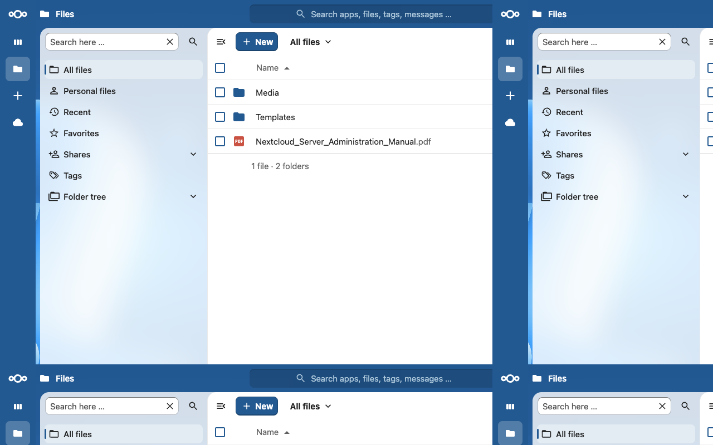
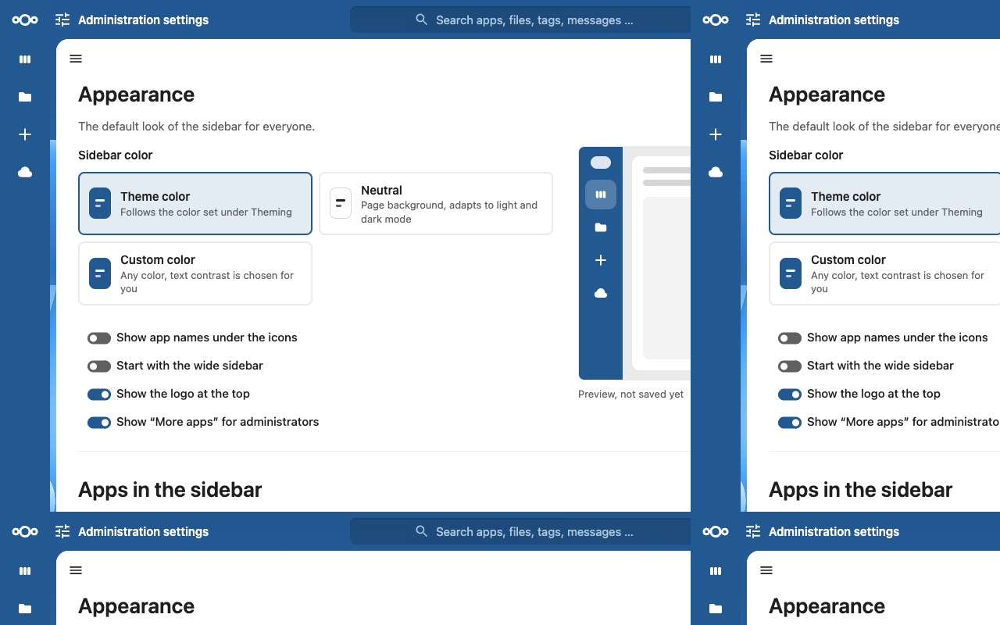

<!--
  SPDX-FileCopyrightText: 2026 André Wiesehoff
  SPDX-License-Identifier: AGPL-3.0-or-later
-->

# Sidebar

A sidebar for Nextcloud. It replaces the apps menu with a column of icons on the left.





Nextcloud 33 to 35. PHP 8.2 to 8.5. The interface is in English and German.

## Install

Enable **Sidebar** under **Apps**, or from the server:

```sh
occ app:enable sidebar
```

The apps menu in the header is replaced by a column of icons on the left. The header shows the open app by name. Search, notifications, and the user menu stay in the header. On screens up to 1024px wide the column becomes a drawer, opened from a menu button in the header.

More pictures for a handbook are in `docs/screenshots/`. `files-wide.png` is the wide column, `drawer.png` is the small-screen drawer, and `personal.png` is the personal settings page.

## Configure

Open **Administration settings**, then **Sidebar**.

The administrator sets the color, the default width, the logo, and which apps are hidden for everyone. People may override the color, the labels, and extra hidden apps only when the administrator allows it. Everyone can still switch between the narrow and the wide column. Hiding an app removes it from the sidebar only. The app stays reachable by its address.

## Privacy

The app stores no user accounts and sends no data to the author. Removing it deletes its settings and everyone's preferences.

## Develop

```sh
composer install
composer test
npm ci
npm run lint
npm run build
```

Publishing to the App Store is in [docs/publish.md](docs/publish.md). The certificate for `sidebar` is not registered yet.

## Skills

Nextcloud agent skills are a local checkout of [nextcloud/nextcloud-skills](https://github.com/nextcloud/nextcloud-skills) in `.nextcloud-skills`. Cursor loads them through `.cursor/skills`. Neither directory is part of the app archive.

```sh
git -C .nextcloud-skills pull
```

## License

[AGPL-3.0-or-later](LICENSES/AGPL-3.0-or-later.txt).
